# documentationArchi – User Guide

documentationArchi is a plugin for [Archi](https://www.archimatetool.com) that turns an ArchiMate model into
documentation people can read without Archi: **HTML pages**, a **PDF document** and **Confluence pages**. Every view
gets its own page with its picture and a description of each element on it, built from the descriptions,
properties and relationships you already keep in the model.

This guide explains every function of the plugin: where to find it, what it needs from you and what it produces.

<p align="center">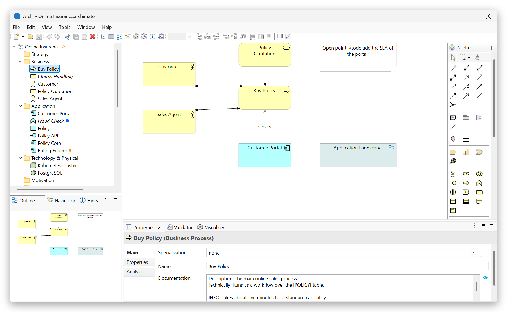</p>

---

## Contents

1. [At a glance](#1-at-a-glance)
2. [Installation](#2-installation)
3. [Quick start](#3-quick-start)
4. [Where the functions are](#4-where-the-functions-are)
5. [Export Documentation](#5-export-documentation)
6. [The exported documentation](#6-the-exported-documentation)
7. [Print Order](#7-print-order)
8. [Work packages (Jira tickets)](#8-work-packages-jira-tickets)
9. [Change marks in the Models tree](#9-change-marks-in-the-models-tree)
10. [Formatting descriptions](#10-formatting-descriptions)
11. [Documentation Formatting (changing the look)](#11-documentation-formatting-changing-the-look)
12. [Assets: pictures and files](#12-assets-pictures-and-files)
13. [Publishing to Confluence](#13-publishing-to-confluence)
14. [Command line and automation](#14-command-line-and-automation)
15. [Where things are stored](#15-where-things-are-stored)
16. [Troubleshooting](#16-troubleshooting)

---

## 1. At a glance

| Function | Where | What it takes | What it gives |
|----------|-------|---------------|---------------|
| [Export Documentation...](#5-export-documentation) | Right-click in the Models tree or in a view | A model, folder, views, elements, relationships or work packages; a target folder; the formats | HTML pages, a PDF and Confluence pages in a folder named after the model |
| [Print Order...](#7-print-order) | Right-click a view (tree or view editor) | A view | The order in which the export describes the view's elements, saved in the model |
| [Link to Work Package...](#8-work-packages-jira-tickets) | Right-click elements | One or more elements | Links between the elements and Jira-ticket work packages |
| [Work Packages...](#8-work-packages-jira-tickets) | Right-click anything in a model | A model | An overview of all work packages, what they change and what isn't exported yet |
| [Insert Reference...](#10-formatting-descriptions) | Right-click one object | One element, relationship, view, note or the model; the element or view to refer to | A `[[ref:id]]` link at the end of the description, showing the target's current name |
| [Describe Here](#element-descriptions) | Right-click elements in an ArchiMate view | Elements of the view | The export describes them on this view's page instead of the first that shows them |
| [Add Asset...](#12-assets-pictures-and-files) | Right-click one object | One element, relationship, view, note or the model; files from disk | The files copied into `Assets`, and a link to them in the description |
| [Change marks](#9-change-marks-in-the-models-tree) | Models tree (automatic) | Nothing – it watches the model | Dots showing what no export reflects yet |
| [Documentation Formatting...](#11-documentation-formatting-changing-the-look) | **Tools** menu, **Preferences > Documentation Export** | Your choice of colours, sizes and keywords | How headings, tokens, SQL, labels and panels look in every export |
| [Command line export](#14-command-line-and-automation) | Archi's command line | A model file and a folder | The same documentation, for CI and scheduled builds |

---

## 2. Installation

### Requirements

- **Archi 4.9 or later**, on Windows or macOS. One plugin file works with every supported Archi version.
- To publish to Confluence: **Python 3.8 or later** on the machine that uploads (no extra packages needed).

| Archi       | Tested in    |
|-------------|--------------|
| 4.9.x       | 4.9.3        |
| 5.0 – 5.3   | 5.1.0, 5.3.0 |
| 5.4 – 5.9   | 5.4.3, 5.9.0 |
| 5.10 and up | 5.10.0       |

### Install

1. Download `documentationArchi-<version>.archiplugin` from the
   [releases page](https://github.com/P3chys/documentationArchi/releases).
2. Start Archi and choose **Help > Manage Plug-ins...**.
3. Click **Install...**, select the downloaded `.archiplugin` file and confirm.
4. Restart Archi when asked.

<p align="center">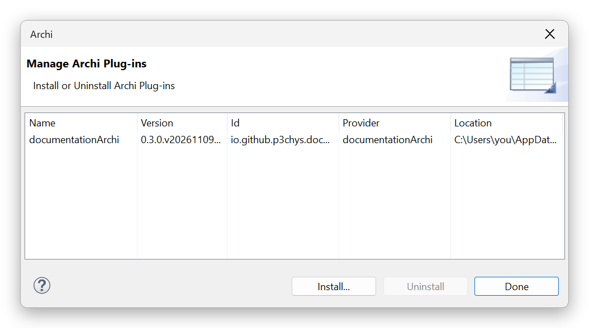</p>

### Check that it works

After the restart:

- right-click the model in the **Models** tree – the menu ends with **Export Documentation...**;
- the **Tools** menu has **Documentation Formatting...**;
- the preferences (**Edit > Preferences...**; on macOS in the **Archi** application menu) have a
  **Documentation Export** page.

### Upgrade

Open **Help > Manage Plug-ins...**, select **documentationArchi**, click **Uninstall**, then install the new file as
above and restart. Your formatting settings, export folder and change marks are kept.

### Uninstall

**Help > Manage Plug-ins...**, select **documentationArchi**, **Uninstall**, restart Archi. Models stay as they are:
print orders and work-package links are ordinary ArchiMate elements and relationships.

> **Windows tip:** don't start Archi from *PowerShell 7 installed from the Microsoft Store*. Store apps run in a
> sandbox that redirects `%APPDATA%` (where Archi keeps its plug-ins and settings), so Archi would not see the plugin.
> Start Archi normally, or from cmd, Windows PowerShell or a winget/MSI install of PowerShell 7.

---

## 3. Quick start

1. Open a model and save it (the plugin looks for assets next to the `.archimate` file).
2. Right-click the model in the **Models** tree and choose **Export Documentation...**.
3. Pick a folder, keep **HTML**, **PDF** and **Confluence** ticked, and click **Export**.
4. When the export finishes, click **Open Folder** and open `html/index.html` or the PDF.

Everything else in this guide refines that result: the order of elements, Jira-ticket exports, formatting, pictures
and publishing.

---

## 4. Where the functions are

The plugin adds its commands to the end of the context menus of the **Models** tree and of the view editors, to the
**Tools** menu, and to the preferences. Its entries are highlighted in the menus below; they appear only when the
selection fits.

<table>
<tr>
<td align="center">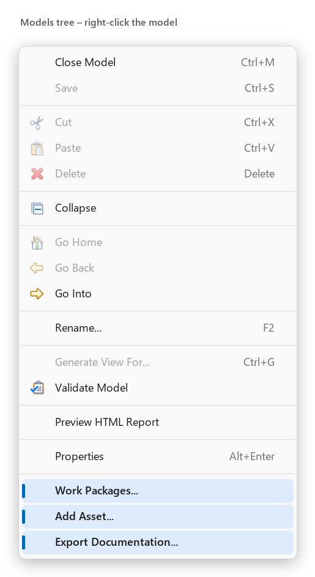</td>
<td align="center">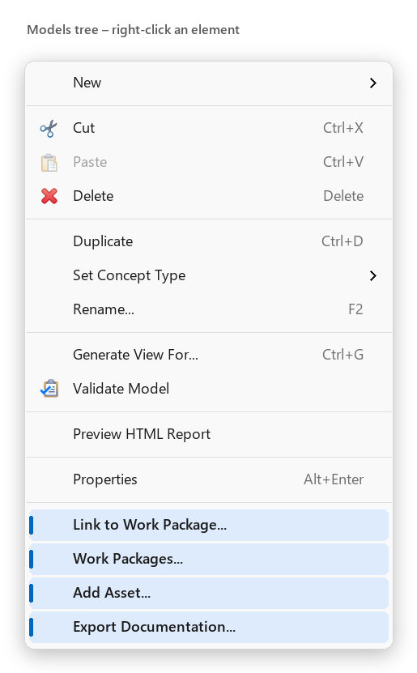</td>
<td align="center">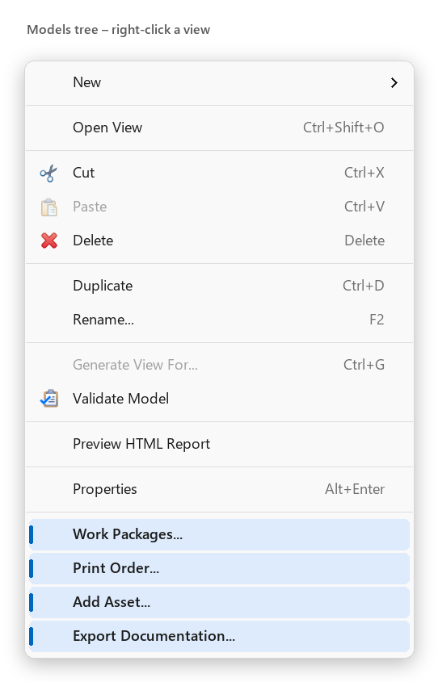</td>
</tr>
</table>

<table>
<tr>
<td align="center" valign="top">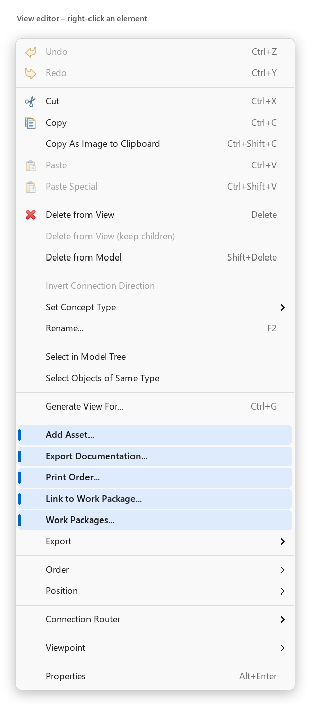</td>
<td align="center" valign="top">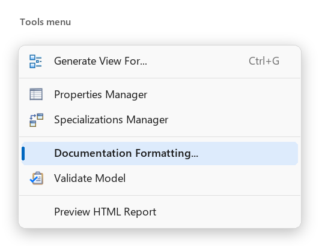</td>
</tr>
</table>

| Command | Models tree | ArchiMate view | Sketch / Canvas view | Shown when |
|---------|:-----------:|:--------------:|:--------------------:|------------|
| Export Documentation... | ✓ | ✓ | ✓ | anything in a model is selected |
| Add Asset... | ✓ | ✓ | ✓ | exactly one element, relationship, view, note or the model |
| Print Order... | ✓ | ✓ | – | one view (tree), or objects of the view (editor) |
| Link to Work Package... | ✓ | ✓ | – | the selection holds elements |
| Work Packages... | ✓ | ✓ | – | anything in a model is selected |
| Check Documentation... | ✓ | ✓ | – | anything in a model is selected |
| Describe Here | – | ✓ | – | the selection holds elements |
| Insert Reference... | ✓ | ✓ | ✓ | exactly one element, relationship, view, note or the model |
| Show in Documentation Preview | ✓ | ✓ | ✓ | anything in a model is selected |
| Documentation Formatting... | **Tools** menu | | | always |
| Documentation Preview | **Window** menu | | | always |

---

## 5. Export Documentation

Produces the documentation of whatever you right-clicked.

**What it takes**

- A selection in the Models tree or in a view (see the table below).
- A target folder and one or more formats.

**What it gives**

- A folder named after the model (or the work package) inside the target folder, holding the HTML pages, the PDF
  and the Confluence pages.

### What gets exported

What you right-click decides the content:

| You select | The export contains |
|------------|---------------------|
| the model | every view, an overview page, a page for elements that are in no view, a *Work packages* page and a *Labels* page |
| work packages | only the elements they change ([details](#export-a-work-package)) |
| a folder | everything in it |
| views | those views |
| elements | a page *Selected elements* describing them |
| a relationship | the elements at both ends |
| objects in a view | their elements; a note or group means its whole view |

### The dialog

<p align="center">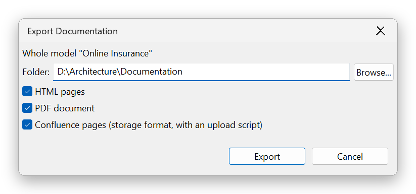</p>

- The first line says what will be exported, for example *Whole model "Online Insurance"* or *2 view(s) and
  3 element(s) of "Online Insurance"*.
- **Folder** – where the export goes; **Browse...** picks it. The export itself goes into a subfolder named after
  the model, for example `online-insurance`.
- **HTML pages**, **PDF document**, **Confluence pages** – the formats. **Export** stays disabled until at least one
  is ticked.

The folder and the formats are remembered for the next export. If the subfolder already holds files, you're asked
before they are replaced.

### While and after it runs

The export runs as a background job (*Exporting documentation*), so you can keep working. When it
finishes, a message says *Exported to &lt;folder&gt;* and offers **Open Folder** and **Close**. If a description
refers to an asset that doesn't exist, the message lists those references (up to 15) and the pages show them in red
– see [Assets](#12-assets-pictures-and-files).

The Progress view shows which view's picture is being drawn and which format is being written. **Cancel** there stops
the export; the previous export in the folder is then exactly as it was, and the change marks in the Models tree
stay as they were. The same holds if an export fails.

### The export folder

```
online-insurance/
├── html/
│   ├── index.html                overview page – open this one
│   ├── sales-overview.html       one page per view
│   ├── elements-not-in-any-view.html
│   ├── work-packages.html
│   ├── labels.html
│   ├── images/                   view pictures
│   ├── assets/                   copies of the assets the pages use
│   └── style.css
├── online-insurance.pdf          the whole documentation as one PDF, with bookmarks
├── assets/                       files the PDF links to
└── confluence/
    ├── pages/                    pages in Confluence storage format
    ├── attachments/              view pictures and assets
    ├── manifest.json
    └── upload_to_confluence.py   the upload script
```

Every export carries its own copies of pictures and files, so you can zip it, mail it or move it without breaking
links.

An export replaces what it owns: `html/`, `confluence/`, the PDF and `assets/` (the PDF's), each only when that format
is exported now. Pages of views you renamed or deleted do not stay behind. Files you put elsewhere in the folder are
never touched, and files you put inside `html/`, `confluence/` or `assets/` are removed, so keep your own files out of
those folders.

---

## 6. The exported documentation

### Overview page

With more than one page, the export starts with an overview: the model's purpose (its description), its properties
and the list of pages.

<p align="center">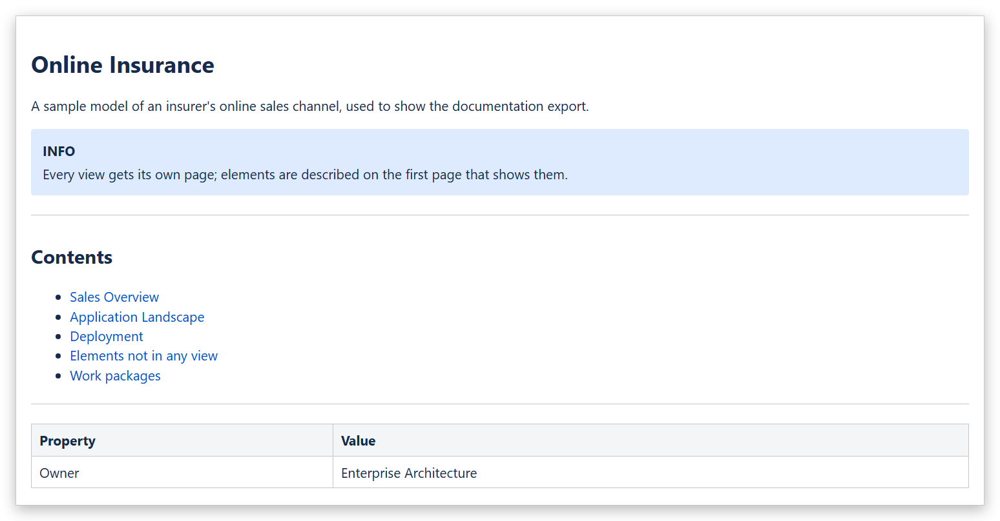</p>

At the bottom of the overview page (and as the last line of the first page of the PDF) one line says which state of the
model it shows: *Generated 2026-11-10 14:03 from Online Insurance*. If the model is shared with
cooperativeArchi (a hidden `.coarchi` folder next to the model file), the line ends with the branch and the short
commit, *– main ＠ 0123456*. If the branch or commit cannot be read, that part is left out. The Confluence pages do not
have this line. (The PDF shows a plain @, its font has no full-width one.)

### View pages

Each view gets a page with, in this order:

1. the view's description,
2. *Contents* – the elements of the view with their types,
3. the view's picture (drawn at twice the size, so it stays sharp in the PDF and when zooming in) – click an element
   in it to go to its description,
4. the view's properties,
5. *Notes* – the text of the notes on the view,
6. *Related views* – views this view refers to,
7. *Elements* – each element described in full.

<p align="center">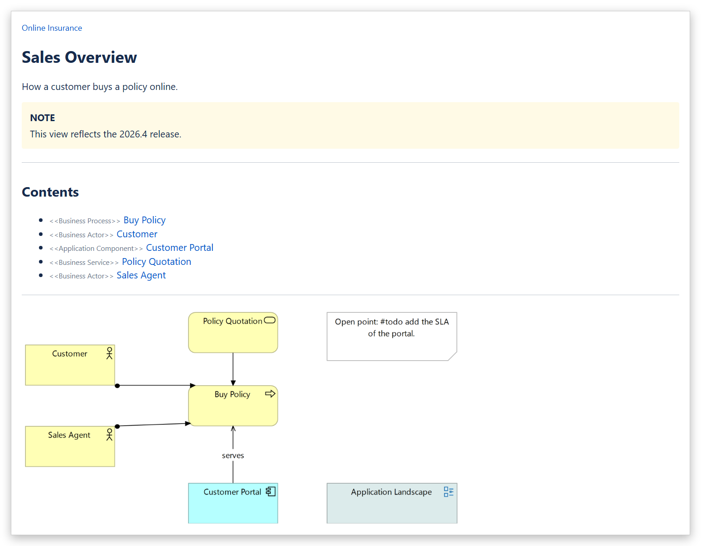</p>

**Clickable pictures:** in the HTML pages and the PDF, every element drawn on a view's picture – nested ones too – is
a link to where it is described: further down the same page, or on the page that describes it. Hover over it on a
web page to see its name. An element that the export describes nowhere (for example one left out of a work package
export) is not a link. On a web page a picture with links is shown at its own width, so the links stay on their
elements; a wide one scrolls sideways instead of shrinking to the window. Confluence pages keep plain pictures.

A **sketch or canvas view** has no elements, so its page shows the picture and, under *Notes*, the texts of its
objects: every sticky, actor, block and group with text, its name in bold above what it says (for a canvas sticky
also its notes), in the order they are on the view. These texts are formatted like any description.

### Element descriptions

Each element is described with its description, its properties, a table of its relationships to other elements of
the view (with each relationship's own description), the views it appears on, its work packages, and its
relationships to elements outside the view, grouped by type.

<p align="center">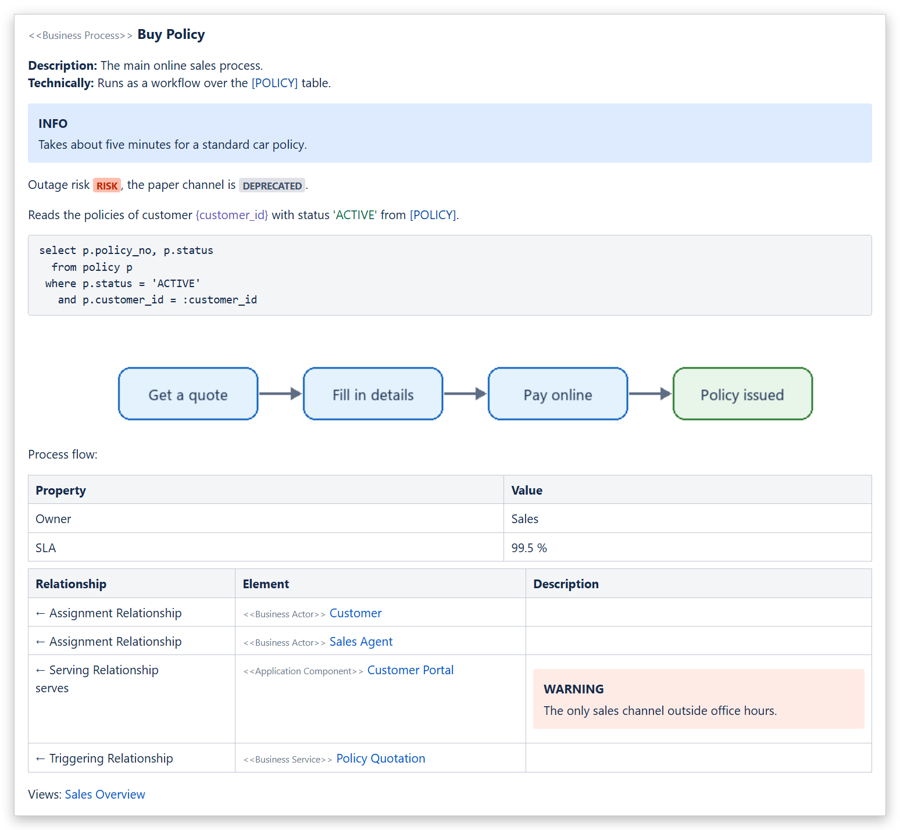</p>

- An element is described **once**, on the first page that shows it. Later pages link to that description. Links
  work in all three formats.
- **Describe Here** chooses that page yourself: select elements in a view, right-click, **Describe Here**. Whenever
  that view is part of an export, the elements are described on its page; when it isn't, the first page that shows
  them describes them as usual. **Describe Here** again on elements already described there takes it back;
  **Edit > Undo** works too. It is kept in the model as a `doc:home` property of the element holding the view's id,
  which never appears among the element's properties in the export.
- Elements are described in alphabetical order unless the view has a [print order](#7-print-order).
- **Groups:** elements that sit in a visual group of the view (Archi's *Group*, not the ArchiMate Grouping) are listed
  under the group's name, in *Contents* and among the descriptions. The groups follow their order on the view, the
  print order applies inside each, and elements in no group come first.
- **Nesting:** an element drawn inside another element on a view, with no relationship between the two, gets
  *Part of: ...* in its description, and the outer one *Contains: ...*. When a relationship connects them, the
  relationship already says how they belong together, so nothing is added.
- The type in front of a name is the ArchiMate type, with the **specialization** after it when the element or
  relationship has one (set in Archi's *Specializations Manager*): *<<Business Actor: Broker>>*,
  *<<Serving Relationship: API call>>*.
- **Junctions** are never described or listed. A relationship that ends in a junction is followed through it – and
  through further junctions after it – to the elements on the other side, and shown as one relationship to all of
  them, joined by *and* (And junction) or *or* (Or junction): for example *→ Check claim or Reject claim*.

### The PDF

The PDF holds the same pages, with bookmarks for every page and page numbers. Large pictures are scaled to fit the
page, and their elements stay clickable at that size.

<p align="center">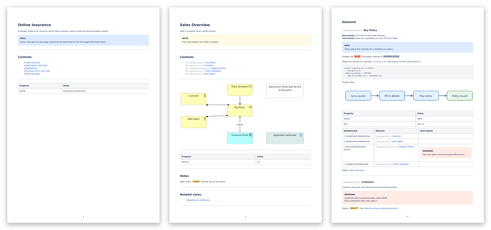</p>

### Documentation Preview

To see how a description comes out without running an export, open **Window > Documentation Preview**, or right-click
anything in the Models tree or in a view and choose **Show in Documentation Preview**. The view shows the selected
object as the HTML export shows it – the same reading of the model, the same formatting rules (the model's
`documentation.rules` if it has one, otherwise your preferences) and the same pictures and assets:

| Selected | The preview shows |
|----------|-------------------|
| a view (or a note or group on it) | its whole page, with its picture |
| an element | its description, with the page it is on (*Described on Sales*) |
| a relationship | the descriptions of the elements at both ends, where its own description is |
| the model | the overview page |
| a junction, PrintOrder or a folder | a line saying why there is nothing to show |

- It follows the selection in the Models tree and in the views. Changes show half a second after you stop – type a
  description in the Properties view and watch it formatted. The focus stays where you type.
- The picture of a view is drawn again only when something on that view changes (or an element on it is renamed).
- Click a link to another element or view, or an element in the picture, to show that one. Web links open in your
  browser, and links to the page's assets open the file with its program if it is a document or picture (PDF, Office
  and OpenDocument files without macros, text, CSV, pictures) – never a program, script or other file, which a model
  shared with you could bring along; other links do nothing. Scripts are off.
- A missing asset shows in red, as in the export. An invalid `documentation.rules` file shows its error instead.
- The preview only reads: it never changes the model, and it does not count as an export for the
  [change marks](#9-change-marks-in-the-models-tree).
- Each element is described where a whole-model export describes it, so an element on several views is described on
  the first page that shows it (or its **Describe Here** view).

---

## 7. Print Order

Sets the order in which the export describes the elements of a view, instead of alphabetical.

**What it takes:** one ArchiMate view – right-click it in the Models tree, or right-click anything on the view in
its editor.

**What it gives:** the chosen order, saved in the model so everyone who exports the model gets the same order.

<p align="center">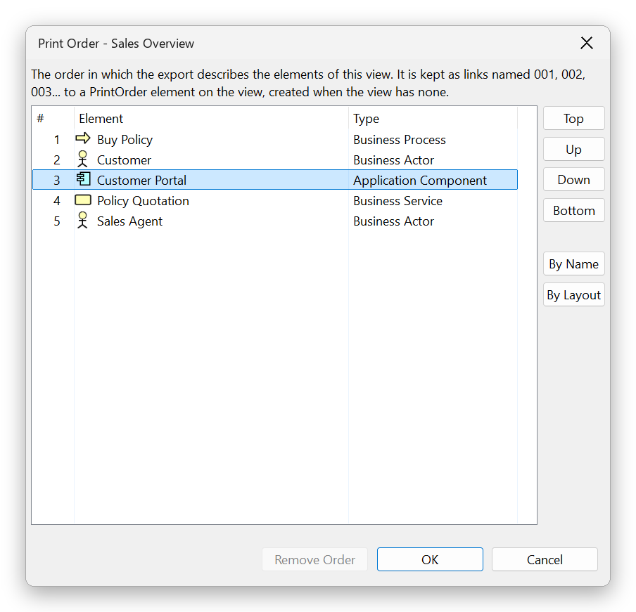</p>

| Control | Does |
|---------|------|
| **Top**, **Up**, **Down**, **Bottom** | move the selected elements; several can be moved together |
| **Alt+Up** / **Alt+Down** | the same from the keyboard |
| drag and drop | moves the selected rows to where you drop them |
| **By Name** | sorts by name |
| **By Layout** | sorts as the elements appear on the view: top to bottom, then left to right |
| **Remove Order** | takes the view's order away, back to alphabetical (enabled only when the view has an order) |
| **OK** | saves the order |

**How it's stored:** a Grouping named `PrintOrder` on the view, with associations named `001`, `002`, `003`...
from each element to it – the way many modellers do it by hand, so you can also draw them yourself. Elements linked
to a PrintOrder come first, by the number in the link's name; the rest follow alphabetically. The PrintOrder element
and its links never appear in the export or its pictures. **Edit > Undo** takes a change back.

---

## 8. Work packages (Jira tickets)

A work package is an ArchiMate **Work Package** element named after a Jira ticket, such as `RBWDP-20025`. Linking
an element to it says *this element changes in that ticket*. Exporting the work package gives developers a
specification of just those elements.

### Link to Work Package

**What it takes:** one or more elements (in the Models tree or in a view).

**What it gives:** association relationships between the elements and the work packages you tick.

<p align="center">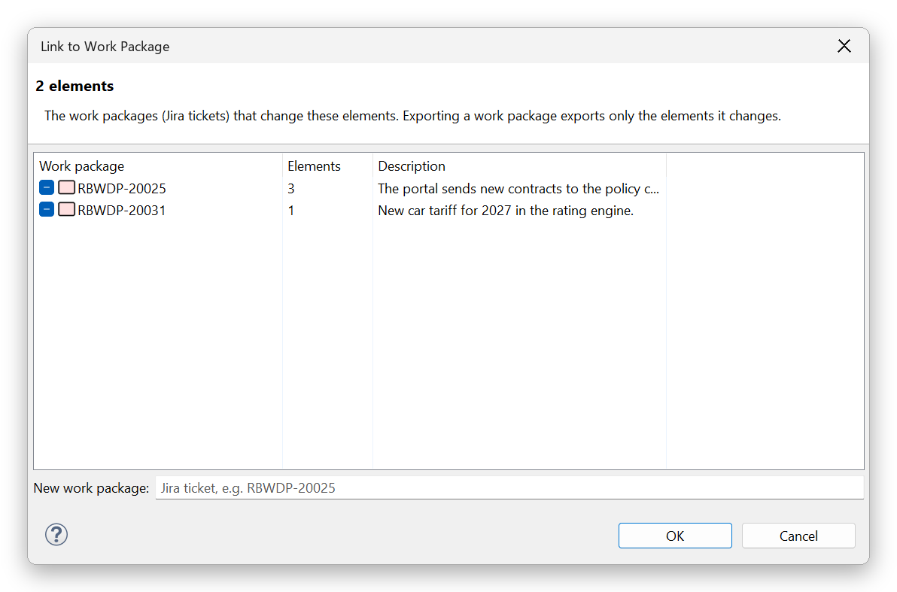</p>

- The table lists every work package of the model, how many elements it changes and the first line of its
  description.
- **Tick** a work package to link all selected elements to it; **untick** it to take them off.
- A **grey tick** (shown as **–**) means only some of the selected elements are linked. It stays as it is unless you
  click it, which links all of them.
- **New work package** creates one and links the selected elements to it. It goes into the *Implementation &
  Migration* folder. The name must start with the ticket key – capital letters, a dash and a number, such as
  `RBWDP-20040` – and may go on with a title; otherwise the dialog says so and **OK** is disabled. Typing the name of
  a work package that already exists links to that one.

<p align="center">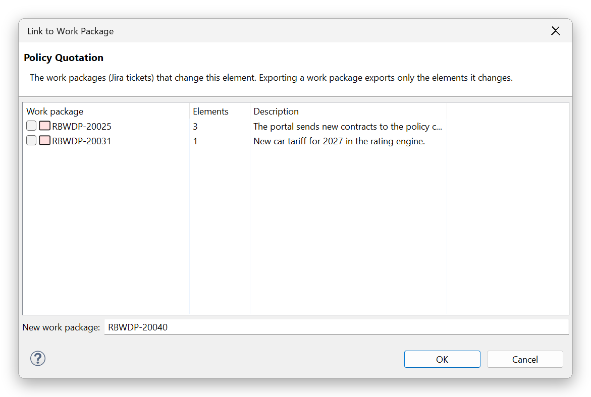</p>

**Edit > Undo** takes the whole change back. The links are plain associations in either direction, so you can draw
them yourself too. An element can be in several work packages.

### Work Packages overview

**What it takes:** a right-click on anything in the model.

**What it gives:** every work package, what it changes and what no export shows as it is now – with export and
navigation from there.

<p align="center">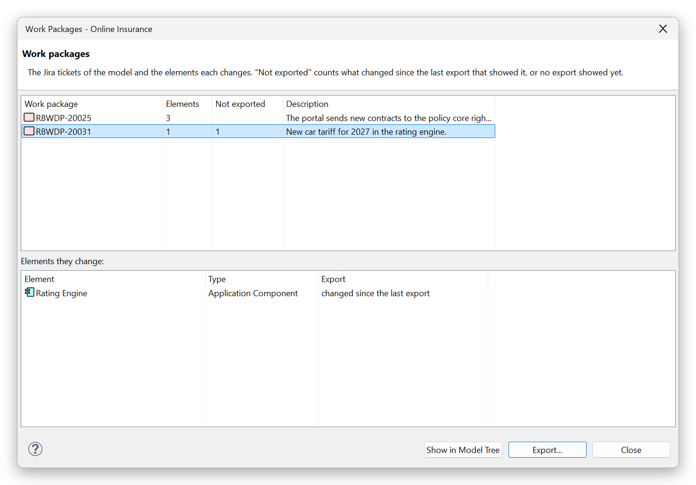</p>

- **Elements** – how many elements the work package changes.
- **Not exported** – how many of them changed since the last export that showed them, or were never exported (see
  [change marks](#9-change-marks-in-the-models-tree)).
- Select one or more work packages to list their elements below. The **Export** column says *in no export yet*,
  *changed since the last export* or *newly linked since the last export*.
- **Export...** (or a double-click) exports the selected work packages.
- **Show in Model Tree** selects the chosen elements – or, if none are chosen, the work packages – in the Models tree.

### Kind of change, closing a ticket, changes without a ticket

**Kind of change:** in **Link to Work Package...** choose the **Kind of change** (*new*, *change*, *remove*). It
becomes the name of the link, so you can also write it on a link you draw yourself, and the documentation shows it
next to the ticket and the element: *Work packages: RBWDP-20025 (new)*. *(not said)* leaves the links as they are.

**Closing a ticket:** when a ticket is done, select it in **Work Packages...** and press **Close**. The work package
stays in the model with its links, but the dialogs, the *Work packages* page and the elements' descriptions no
longer list it; exporting it directly still gives its specification. Tick **Show closed work packages** to see them
and **Reopen** one. Closing sets the property `doc:closed` on the work package, and **Undo** takes it back.

**What changed without a ticket:** **Changed Since Publish...** in **Work Packages...** finds the elements that the
documentation shows differently from what was published (see *Publishing*) and that no open work package changes
yet, and opens **Link to Work Package...** on them, with the kind of change it found: *new* for an element added
since, *change* for one that says something else.

### Export a work package

Right-click one or more work packages and choose **Export Documentation...**, or use **Export...** in the overview.

<p align="center">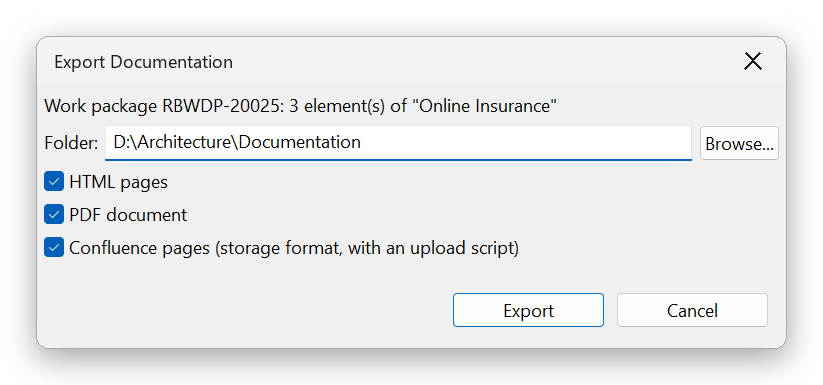</p>

The export holds:

- a first page named after the ticket, with the work package's description and properties (the specification) and
  the elements it changes;
- the views showing any of these elements – each with its full picture, but describing only those elements;
- the elements that are on no view.

In every export, an element's description ends with the work packages that change it, and a whole-model export has a
*Work packages* page describing each ticket:

<p align="center">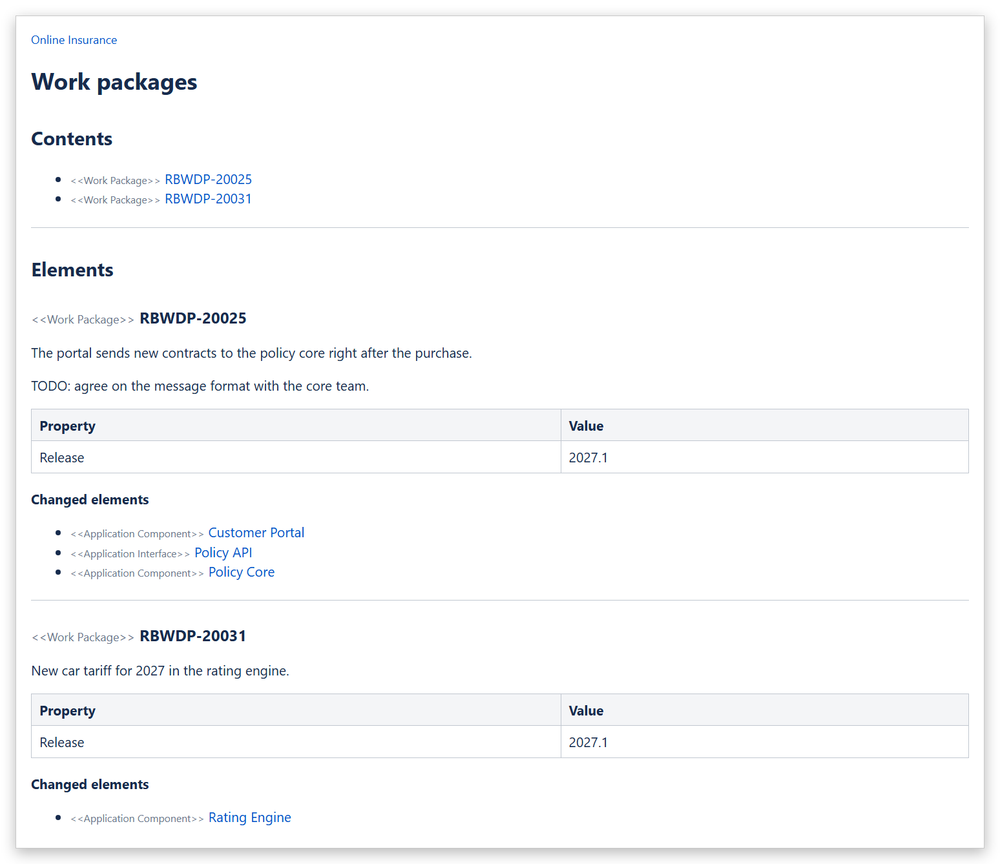</p>

---

## 9. Change marks in the Models tree

The Models tree shows, with a small mark after the name, what no documentation export reflects yet – so you know
what to export before you hand documentation over.

<p align="center">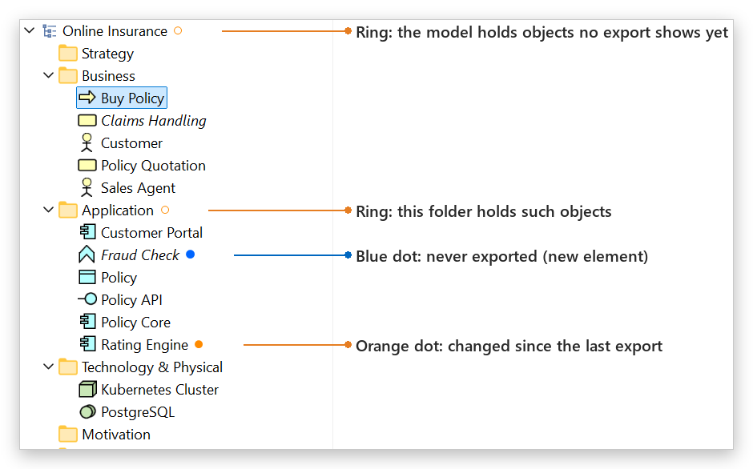</p>

| Mark | Means |
|------|-------|
| orange dot | the element, relationship or view changed since the last export that showed it |
| blue dot | no export has shown it yet (new, or never exported) |
| orange / blue ring | a folder (or the model) holding such objects, so you find them with the tree collapsed |
| light orange dot / ring | only the layout changed since the last export (a box moved or resized, bend points, fonts, colours) |

**Layout-only changes.** Moving a box does not change what the documentation says, so it gets the lighter mark with
its own tooltip. Names, descriptions, properties, which objects are on a view and the texts on it are content: a
change there gets the normal orange mark. Tick **Ignore layout-only changes** in the preferences (default off) to
hide the light marks. The view's picture in an export is redrawn either way; the mark only tells you whether a new
export is needed for the text. Marks from exports made by an older version stay as they were and cannot tell layout
from content until the next export.

- Hover over a mark to see what it means and when the object was last exported.
- **Any** export counts: exporting a work package brings its elements up to date.
- A view counts as changed when anything on it moves or changes, or an element on it is renamed, because its picture
  changes.
- PrintOrder elements and their links never get a mark.
- To hide the marks, untick **Mark in the model tree what no export shows yet** in
  [Preferences > Documentation Export](#11-documentation-formatting-changing-the-look).

### Publishing: what the readers have

Tick **Publish** in the export dialog when an export is the documentation your readers get. The plugin then notes
what that export shows in a file `documentation.published` next to the model file, and two things follow:

- **Marks for the whole team.** An object counts as exported if your own exports show it as it is, or the published
  documentation does. Share the file with the model (cooperativeArchi 1.6.1 and later does it for you; otherwise copy
  it) and a colleague who never exported anything sees the same marks as you: only what the readers don't have yet.
- **A page "Changes since ...".** Every later export of the whole model starts with a page listing the views and
  elements added, changed and removed since the documentation was published, with each changed name, description,
  property and relationship before and after, and links to where they are described now.

Publishing a part (a work package, some views) keeps what was published of the rest. An export without **Publish**
is a preview: it changes nothing in that file. The model must have been saved, so the plugin knows where the file
goes. The file is text and is written in the same order each time; it is not meant to be edited.

---

## Check Documentation

Problems in the documentation are otherwise found only by reading the output. Right-click anything in a model and
choose **Check Documentation...**: it lists what it finds, grouped by kind with counts, and exports nothing.

- elements and views without a description,
- elements that are on no view (work packages are not expected on one),
- views (ArchiMate) without elements,
- `[[asset:...]]` references whose file is missing or ambiguous (several files have that name),
- `[[ref:...]]` references to objects that no longer exist,
- `#words` that look like a label but are not a configured one: they differ from one by one or two characters
  (`#rsik` for `#risk`),
- work packages that change no element.

Objects the rules leave out of the export are not checked.

Select findings (or a whole kind) and choose **Show in Model Tree** to select their objects there. On the command line,
`--documentation.check` prints the same list; with `--documentation.strict` the run fails when there are findings.

---

## 10. Formatting descriptions

Write these markers in any description (of the model, a view, an element or a relationship), in notes and in
property values. They look the same in HTML, the PDF and Confluence (where they become Confluence's own panels,
status labels and code blocks).

| Write | Result |
|-------|--------|
| `INFO: text`, `NOTE: text`, `TIP: text`, `WARNING: text` at the start of a line | a coloured panel with that title, up to the next blank line |
| `<#>a remark</#>` (or up to the next blank line) | a note panel without a title |
| `#risk` or `[[risk]]` | a label; built in: `risk` (red), `deprecated` (grey), `todo` and `draft` (yellow), `new` (green) |
| `Description:`, `Technically:` anywhere | bold |
| `[ORDERS]` | a table name, coloured |
| `'ACTIVE'` | a constant, coloured |
| `{client_id}` | a variable, coloured |
| `<sql>select ...</sql>` | an SQL code block |
| `https://...` | a link |
| `[[asset:file.png]]` | a picture or file from the Assets folder – see [Assets](#12-assets-pictures-and-files) |
| `- item`, `* item`, `1. item` at the start of a line | a bullet or numbered list; an indented line goes on with the item |
| `**bold**`, `*italic*` | bold, italic (a `*` with a space or a digit beside it, as in `select *` or `2*3`, stays a `*`) |
| `[the spec](https://...)` | a link with that text (`[ORDERS]` alone stays a table name) |
| a `\| A \| B \|` line, then `\|---\|---\|`, then rows | a table with a header row; without the line of dashes the `\|` stays text |
| ```` ```java ```` ... ```` ``` ```` or `<code lang="java">...</code>` | a code block, the language optional (in Confluence: the code macro) |
| `[[ref:<id>]]`, `[[ref:<id>\|label]]` | a link to that element or view showing its current name, or the label; its plain name when the export leaves it out |
| a blank line | a new paragraph; single line breaks stay |

Keywords ignore case. Labels and panels only work for configured keywords, so other `#words` stay as they are. You
can add your own keywords – see the next section.

**Lists, tables, emphasis, links and code** look the same in all three formats. A few rules keep older text as it
was: a `*` only makes italic or bold with text right inside it and nothing word-like outside, so `select * from`,
`count(*)` and `2*3*4` stay as they are; a table needs the line of dashes under its first row, so a `|` in a sentence
stays a `|`; `[ORDERS]` stays a table name unless `(https://...)` follows it directly. Inside a table cell, write `\|`
for a `|`. A code block marked `sql` looks like an `<sql>` block. In panels, lists and tables work too.

**References.** `[[ref:<id>]]` links to an element or view by its Archi id and always shows its current name.
**Insert Reference...** writes one for you: right-click one element, relationship, view, note or the model (in the
Models tree or in a view), pick the element or view to refer to (type to filter the list), and the reference goes at
the end of the description. **Edit > Undo** takes it back. When the export doesn't contain the target, its name is
shown as plain text; an id the model doesn't have shows in red as *[missing reference: id]*.

**The Labels page.** A whole-model export ends with a *Labels* page that collects them: for each configured label
that occurs (`#risk`, `#todo`, your own...), the views, elements and relationships whose description, notes or
property values carry it, each a link to where it is described. A relationship links to the element it is described
with. Labels nobody uses are left out, and without any label there is no such page.

**Example.** This description of *Buy Policy*:

```text
Description: The main online sales process.
Technically: Runs as a workflow over the [POLICY] table.

INFO: Takes about five minutes for a standard car policy.

Outage risk #risk, the paper channel is [[deprecated]].

Reads the policies of customer {customer_id} with status 'ACTIVE' from [POLICY].

<sql>
select p.policy_no, p.status
  from policy p
 where p.status = 'ACTIVE'
   and p.customer_id = :customer_id
</sql>

Process flow: [[asset:process/buy-policy.png|Buy Policy process flow]]
```

is exported as shown in [Element descriptions](#element-descriptions).

---

## 11. Documentation Formatting (changing the look)

**Where:** **Tools > Documentation Formatting...**, or **Preferences > Documentation Export** (the same page, shown
inside the preferences).

**What it takes:** your choice of colours, sizes, effects and keywords.

**What it gives:** the look of every later export, in all three formats. The settings are kept in Archi's
preferences on your computer, not in the model.

<p align="center">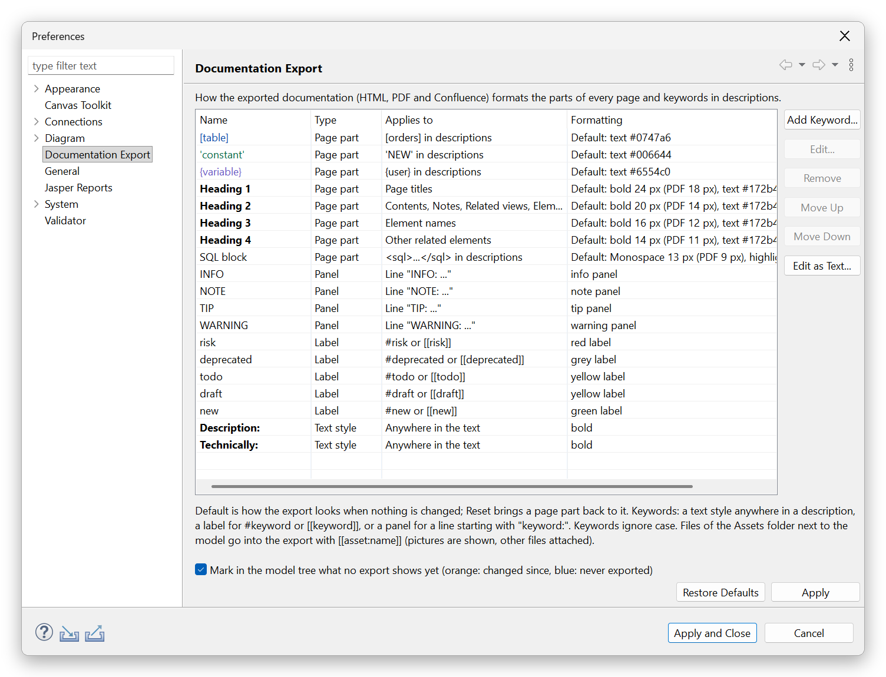 Documentation Export"></p>

The list holds everything whose look can change:

- **Page parts** – the `[table]`, `'constant'` and `{variable}` tokens, headings 1–4 and SQL blocks. They are always
  there; **Edit...** changes one and **Reset** (the *Remove* button, when page parts are selected) brings it back to
  the default shown in the *Formatting* column.
- **Keywords** – panels, labels and text styles. **Add Keyword...**, **Edit...**, **Remove**, **Move Up** and
  **Move Down** manage them. Double-click a row to edit it.
- **Edit as Text...** – all rules as text, see [below](#edit-as-text).
- **Mark in the model tree what no export shows yet** – switches the [change marks](#9-change-marks-in-the-models-tree)
  on or off.
- **Restore Defaults** brings back the built-in keywords and page-part looks.

### Add or edit a keyword

Choose the **Type** first; the options below it change with it. Every editor shows a live preview.

<table>
<tr>
<td align="center" valign="top">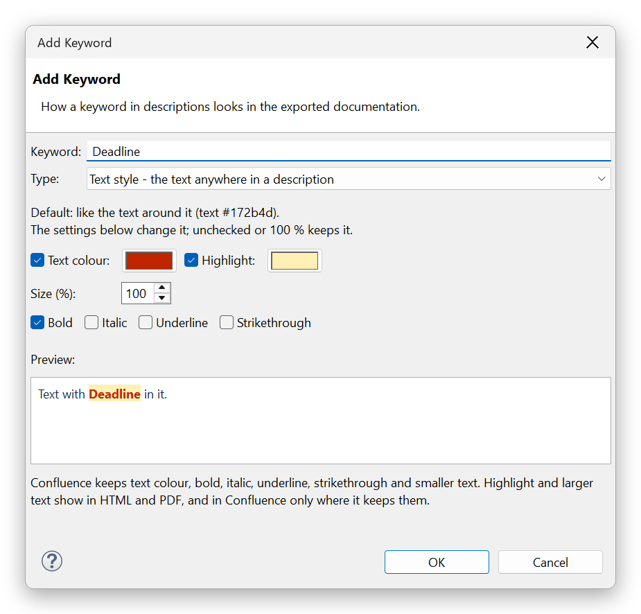<br><b>Text style</b> – this text always gets a colour, highlight, size, bold, italic, underline or strikethrough</td>
<td align="center" valign="top">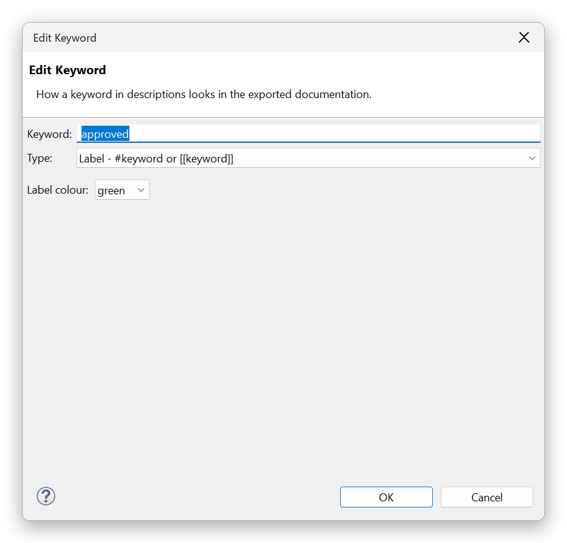<br><b>Label</b> – <code>#keyword</code> or <code>[[keyword]]</code> becomes a grey, red, yellow, green or blue label</td>
</tr>
<tr>
<td align="center" valign="top" colspan="2">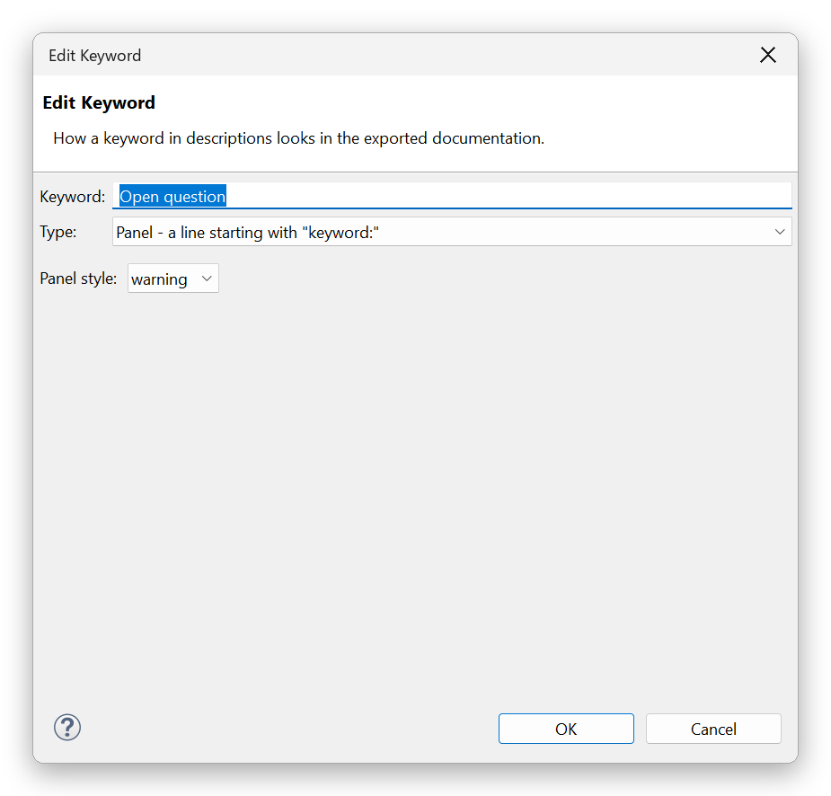<br><b>Panel</b> – a line starting with <code>keyword:</code> becomes an info, note, tip or warning panel</td>
</tr>
</table>

- A panel keyword is at most 40 characters and has no `:`; a label keyword cannot contain `]`.
- A keyword of the same type and name as an existing one replaces it.

### Edit a page part

Selecting a page part and clicking **Edit...** opens the same style editor, starting from the default look. For
**SQL block** it also sets Confluence's code block **Theme** and **Line numbers**.

<table>
<tr>
<td align="center" valign="top">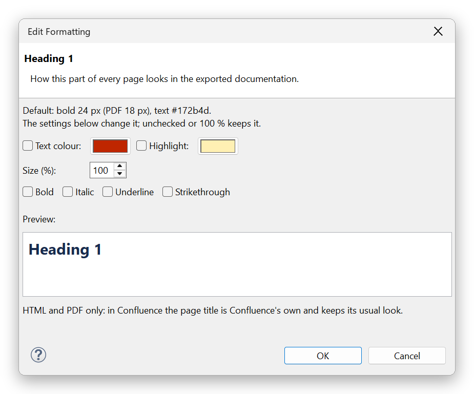</td>
<td align="center" valign="top">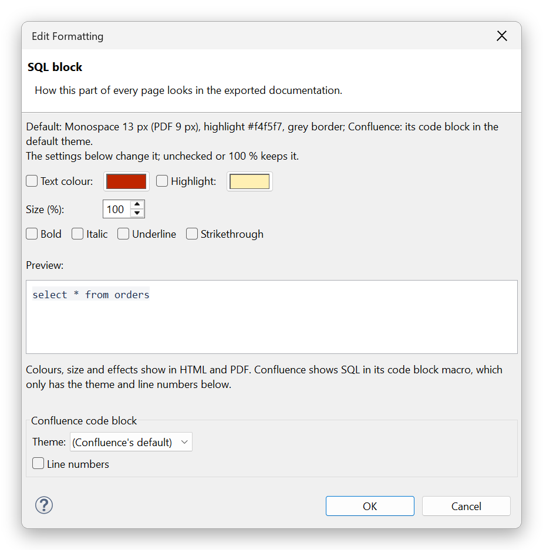</td>
</tr>
</table>

Confluence keeps text colour, bold, italic, underline, strikethrough and smaller text. It doesn't keep every
background or larger size in every version; the editors say so where it matters.

### Edit as Text

Shows all rules as text, one per line – to copy them to another computer or change many at once. Lines starting with
`#` are explanations and are not kept. An invalid line is reported at the top and **OK** stays disabled until it's
fixed.

<p align="center">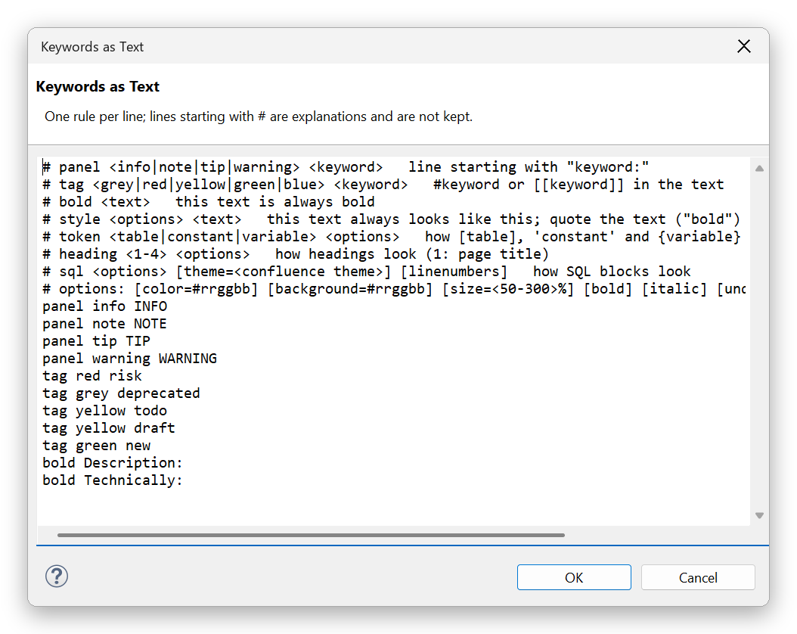</p>

```text
panel warning Open question            a line "Open question: ..." becomes a warning panel
tag red risk                           #risk or [[risk]] becomes a red label
bold Description:                      this text is always bold
style color=#bf2600 background=#ffebe6 size=120% bold italic Deadline
token variable color=#6554c0 italic    how {variable} looks; also table and constant
heading 2 color=#0052cc size=120%      how headings of a level (1-4) look
sql background=#f4f5f7 theme=midnight linenumbers
```

### Project rules

To make everyone (and the CI build) format a model the same way, keep the rules next to the model: a file named
`documentation.rules` in the folder of the `.archimate` file, in the same text format as **Edit as Text...**. When it
exists, every export of that model uses it instead of the preferences; without it the preferences apply, and without
those the built-in defaults.

**Save as Project Rules...** (in the button column) writes the rules of the list to that file for a model you choose
from the open, saved ones. Below the list, a line names the open models that use project rules, and the export dialog
says so for the model it exports. If the file has an invalid line, the export stops and tells you the file and the
line; it does not quietly use other rules.

### Leaving things out

Everything in a model is exported unless you leave it out:

- **A property `doc:exclude`** on a view, element, relationship or folder (any value but `false`) leaves it out of every
  export; for a folder, everything in it. The element is gone from the pictures of views as well, and so are the
  relationships to it. A link to it in a description (`[[ref:...]]`) shows its plain name.
- **`exclude label draft`** (a rule line) leaves out every view, element and relationship whose description carries
  `#draft` or `[[draft]]`.
- **`hide property internal*`** (a rule line, as many as you like) never prints properties with that key. Case does
  not matter, and a `*` at the end matches any ending. The `doc:` properties (`doc:exclude`, `doc:home`) are never
  printed.

What you select yourself is still exported: right-click an excluded view and export it, and you get it. When the
export finishes, its message says how many objects the rules left out. The rule lines work in the preferences, in
`documentation.rules` and on the command line alike.

### Language and fixed texts

The fixed texts of the output ("Contents", "Notes", "Property", "Related views"...) are English. The rule line
`language cs` prints them in Czech instead (`language en` is the default). To change a single one, add
`text <key> = <replacement>`, for example `text contents = Table of contents`; this works in either language. The keys
are `contents`, `elements`, `notes`, `related-views`, `other-related-elements`, `changed-elements`, `work-packages`, `property`, `value`, `relationship`, `element`, `description`, `name`, `token`, `used-in`, `tables-index`, `variables-index`, `constants-index`, `views`, `part-of`, `contains`, `labels`, `group`, `elements-not-in-any-view`, `selected-elements`, `generated`, `missing-asset`, `missing-reference`. `generated` keeps the placeholders `{time}` and `{model}`. The names of element and relationship types stay as
Archi calls them, and so does the text you wrote. As every rule line, these work in the preferences, in
`documentation.rules` and on the command line. A wrong language or key is reported with its line.

### Export profiles

An export is set up by hand: what to select, which formats, which folder. A **profile** is a named set-up kept with
the model, so everyone and the command line export the same. It is a rule line in `documentation.rules`:

```text
profile developers folders=Views/Sales,Views/Claims formats=html,pdf exclude=#internal hide=cost* language=en output=docs/dev publish
profile "Sales team" views="Order flow",Overview output=docs/sales
```

| Setting | Meaning |
|---------|---------|
| `folders=` `views=` `workpackages=` | what to export, comma separated, as on the command line; none: the whole model. Work packages cannot be combined with folders or views |
| `formats=` | `html`, `pdf`, `confluence` |
| `exclude=` | more labels to leave out, on top of the `exclude label` lines |
| `hide=` | more property keys never to print (`*` at the end matches any ending) |
| `language=` | `en` or `cs` |
| `output=` | the export folder; relative to the folder of the model file unless absolute. The export goes straight into it, without a subfolder |
| `publish` | the export is published, see [Publishing](#publishing-what-the-readers-have) |

Names and values with spaces are quoted. A mistake is reported with the file and line, like the other rule lines, and so
is a folder or view that does not exist, when the export runs.

In Archi, the export dialog has a **Profile** list ("(none)" first). Choosing one fills in and locks what the profile
sets. The context menu of the model has **Export Profile**, with one entry per profile; it runs the profile without
the dialog (what the profile does not set comes from the last export dialog), and replaces the files in the folder.
On the command line: `--documentation.profile <name>`; `--documentation.folder` is then optional when the profile has
`output=`, and any option given explicitly overrides the profile's setting.

### Catalogs

A catalog is a page with a table of the elements of one type. A rule line adds it to exports of the whole model:

```text
catalog "Applications" type=Application Component|Application Service folder=Application/Core columns=name,Owner,description
```

| Setting | Meaning |
|---------|---------|
| the title (quoted) | the title of the page |
| `type=` | the element types as the export prints them (`Application Component`); `*` at the end matches any ending (`Application*`); several are separated by `|` |
| `folder=` | optional: only elements in this model folder and below, a path like `Application/Core` |
| `columns=` | `name` (links to the element's description), `description` (its first paragraph), or a property key |

There is one row per described element, sorted by name. The page is listed on the overview page. A catalog without
any row is left out, and the message at the end of the export says so. Catalogs are not part of exports of selected
views, folders or work packages.

### Data usage index

Descriptions mark database tables as `[ORDERS]`, variables as `{client_id}` and constants as `'ACTIVE'` (see section 10). A rule line adds a page to exports of the whole model that lists
every one of them:

```text
index tables
index variables
index constants
```

The page lists each token once, sorted by name, with links to where it is used: the descriptions, notes and property
values of the views, elements and relationships. Upper and lower case count as the same token. The tokens are found
the way the text is coloured, so the index never disagrees with the pages. In an SQL block only a table written as
`[ORDERS]` counts. An index that finds nothing is left out, and the message at the end of the export says so. Without
the lines nothing changes.

### Page template

The order of the parts of a page is fixed, unless you say otherwise with two rule lines:

```text
page description contents picture properties notes related elements
entry description properties relations views workpackages other
```

`page` lists the sections of a view's page to print, in this order: the view's description, the list of its elements
(`contents`), the picture, the view's properties, the texts of the notes, the related views (`related`; on the Labels
page, its labels) and the described elements (`elements`). `entry` does the same for one element's description: its
description, properties, `relations` (part of, contains, the elements a work package changes, and the table of
relationships), the views it is on, its work packages and the relationships to elements outside the view (`other`).
A section or part you leave out is not printed (leave out `elements` and the links to the elements lead nowhere). An
unknown or repeated name is an error, reported with its line. Without the lines the output is as it always was.

---

## 12. Assets: pictures and files

Keep pictures and documents in a folder named `Assets` next to the `.archimate` file (subfolders are fine) and put
them into the documentation from any description, note or property value.

### Add Asset

**What it takes:** exactly one element, relationship, view, note or the model (right-click it in the Models tree or
in a view), and one or more files you pick. The model must have been saved, so the plugin knows where `Assets` is.

**What it gives:**

- the files copied into `Assets` (created if missing). A file already inside `Assets` is used where it is; the same
  file picked again is reused; a different file with the same name is saved with `-2`;
- one `[[asset:...]]` line per file at the end of the description.

**Edit > Undo** removes the lines; the copied files stay.

### Referring to assets by hand

| Write | Result |
|-------|--------|
| `[[asset:process/buy-policy.png]]` | the picture, shown in the text |
| `[[asset:process/buy-policy.png\|Buy Policy process flow]]` | the same, with that alternative text |
| `[[asset:contracts/SLA 2026.pdf\|the SLA]]` | a link "the SLA" that opens the file |
| `asset:tariff.csv` | short form, for names without spaces |

- A file name alone is enough when only one file in `Assets` has it; otherwise use its path inside `Assets`. Case
  and `/` or `\` don't matter.
- PNG, JPEG, GIF, BMP and SVG are pictures; anything else is a file to open.
- Large pictures are shown smaller, keeping their proportions: in the PDF never wider or taller than a page; on HTML
  and Confluence pages at most about 860 pixels high – click to see full size.

### How each format carries them

| Format | Assets |
|--------|--------|
| HTML | copied to `html/assets/` |
| PDF | pictures are drawn into the PDF; other files (and SVG) are links to the copy in `assets/` next to the PDF, and are also attached inside the PDF |
| Confluence | attachments of the page |

A reference that finds no file shows in red as *[missing asset: name]* and is listed when the export finishes. Only
files really inside `Assets` are used: links pointing outside it are ignored and reported, so a model shared with you
can't pull other files from your computer into an export.

---

## 13. Publishing to Confluence

The Confluence export contains ready-made pages in Confluence's storage format – links, panels, labels, code blocks,
pictures and assets as attachments – plus a script that uploads them to **Confluence Data Center / Server**.

**What it takes:** Python 3.8+, the Confluence URL, a space key and a personal access token (or user name and
password).

**What it gives:** one Confluence page per exported page, with its attachments.

```bash
CONFLUENCE_TOKEN=<personal access token> python online-insurance/confluence/upload_to_confluence.py \
  --url https://confluence.example.com --space ARCH
```

| Option / variable | Meaning |
|-------------------|---------|
| `--url` | Confluence base URL (required) |
| `--space` | space key (required) |
| `--parent "Existing page"` | put the pages under an existing page |
| `CONFLUENCE_TOKEN` | personal access token |
| `CONFLUENCE_USER`, `CONFLUENCE_PASSWORD` | used when there is no token |

Pages are matched by title, and existing ones get a new version, so you can upload the same export again after
changes. Page titles start with the model name, because Confluence titles must be unique in a space.

The pictures of views are plain pictures in Confluence: clicking an element in them leads nowhere, unlike in the HTML
pages and the PDF.

---

## 14. Command line and automation

For CI pipelines and scheduled documentation builds, the plugin adds an option to Archi's command line:

```bash
Archi -application com.archimatetool.commandline.app -consoleLog -nosplash \
  --loadModel model.archimate --documentation.folder out [--documentation.formats html,pdf,confluence]
```

| Option | Meaning |
|--------|---------|
| `--documentation.folder` | export the whole model's documentation to this folder |
| `--documentation.formats` | comma separated `html`, `pdf`, `confluence`; default: all three |
| `--documentation.workPackages KEY[,KEY]` | only these work packages: names, or the ticket key a name starts with (`RBWDP-20025`) |
| `--documentation.views a,b` | only these views: names or ids |
| `--documentation.folders Views/Sales` | only the views and elements in these folders (paths from the top folder) |
| `--documentation.rules file` | formatting rules from this file, instead of `documentation.rules` next to the model |
| `--documentation.profile name` | export as this profile of the rules says (see Export profiles); `--documentation.folder` is then optional, and options given here override the profile |
| `--documentation.check` | list what is missing or wrong in the documentation (see Check Documentation); with `--documentation.strict`, findings fail the run |
| `--documentation.strict` | missing assets also fail the run (unknown names always do) |
| `--documentation.publish` | note this export as the published documentation, in `documentation.published` next to the model |

Without `--documentation.workPackages`, `--documentation.views` and `--documentation.folders` the command line exports
the whole model. Views and folders can be combined (`--documentation.views Overview --documentation.folders Views/Sales`);
work packages cannot be mixed with them, run the export twice instead. Names are matched exactly; a work package by its
name or by the ticket key its name starts with, a folder by its path from the top folder (the folder names Archi shows,
`Views` for example). A name that matches nothing, or a view name shared by several views, stops the run with an error
that lists every name not found.

**Failing a build.** Archi's command line providers signal failure by throwing an error, and Archi ends with a
non-zero exit code only when you also pass its own `--abortOnException`. For CI use both:

```bash
Archi -application com.archimatetool.commandline.app -consoleLog -nosplash --abortOnException \
  --loadModel model.archimate --documentation.folder out --documentation.strict
```

An invalid rules file (the project file or the one given with `--documentation.rules`) always fails the run and names
the file and line. The command line exports the whole model by default and uses the project rules file of the model if there is one, else the formatting settings of the Archi installation it runs in.
Missing assets are logged as errors, and with `--documentation.strict` they fail the run.

---

## 15. Where things are stored

| What | Where | Shared with others? |
|------|-------|---------------------|
| Print orders | in the model (PrintOrder grouping and links) | yes, with the model |
| Work packages and their links | in the model (Work Package elements, associations) | yes, with the model |
| Describe Here | in the model (the element's `doc:home` property) | yes, with the model |
| Asset files | the `Assets` folder next to the model file | yes, if you share the folder |
| Formatting and keywords | Archi's preferences on your computer | no – use **Edit as Text...** to copy them |
| Project rules (`documentation.rules`) | next to the model file | yes, if you share the folder |
| Export folder and formats | Archi's preferences on your computer | no |
| What each export showed (change marks) | Archi's settings folder, per model, per computer | no – exporting never changes the model |
| What the published documentation shows | `documentation.published` next to the model file | yes, if you share the file (cooperativeArchi does) |

---

## 16. Troubleshooting

| Problem | Solution |
|---------|----------|
| The menu entries don't appear | Restart Archi after installing. Check **Help > Manage Plug-ins...** lists documentationArchi. On Windows, don't start Archi from PowerShell 7 from the Microsoft Store (see [Installation](#2-installation)). |
| *Save the model first: its assets are kept in the Assets folder next to the model file.* | **Add Asset...** needs the model saved to a file. Save it and try again. |
| *The work package ... changes no elements yet.* | Link elements to it with **Link to Work Package...** first. |
| *Select the elements a work package changes (work packages themselves can't be linked).* | Select ordinary elements, not work packages. |
| *The selection spans several models.* | Select objects of one model only. |
| *The view shows no elements to order.* | The view holds only notes, groups or references; there is nothing for the print order. |
| A picture shows as *[missing asset: name]* in red | The file isn't in `Assets`, the name matches several files (use its path), or it links outside `Assets`. The export's final message lists each case. |
| The PDF can't show an SVG | SVG files become links to the copy in `assets/` next to the PDF. Use PNG for pictures that must appear in the PDF. |
| Old plugin still active after an upgrade | Uninstall the old version in **Manage Plug-ins** before installing the new one, then restart. |
| The change marks are distracting | Untick **Mark in the model tree what no export shows yet** in **Preferences > Documentation Export**. |
